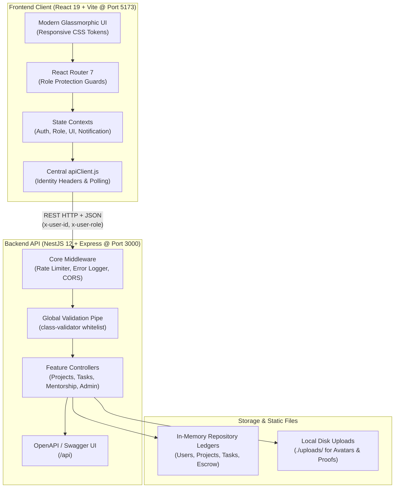

# TeamForge — Student Project Collaboration Platform

A unified, full-stack collaborative platform connecting student project creators, peer contributors, and industry/faculty mentors. TeamForge coordinates the complete lifecycle of academic and open-source student projects—from project scoping and team recruitment to deliverable execution, live workspace communication, escrow-protected mentorship sessions, and administrative governance.

---

## Submission Package Notice (Course Project Submission)

This repository package directly addresses the three mandatory project submission requirements:

| Submission Item | Required Component | Implementation in this Package |
| :---: | :--- | :--- |
| **1** | **Complete Project**<br>All source code and required project files | Located in [`COMPLETE-PROJECT-SOURCE-CODE/`](./COMPLETE-PROJECT-SOURCE-CODE/)<br>• Backend API: [`COMPLETE-PROJECT-SOURCE-CODE/back-end/`](./COMPLETE-PROJECT-SOURCE-CODE/back-end/)<br>• Frontend SPA: [`COMPLETE-PROJECT-SOURCE-CODE/React-Implementation/`](./COMPLETE-PROJECT-SOURCE-CODE/React-Implementation/) |
| **2** | **README.md**<br>Project setup, dependencies, execution steps, and testing instructions | This document ([`README.md`](./README.md)), providing comprehensive documentation of prerequisites, environment configuration, multi-service execution, automated & static checks, API smoke tests, and 13 manual end-to-end evaluation flows. |
> [!NOTE]
> **Instructions for Individual Student ZIP Submissions**:
> In accordance with course guidelines, each student submits an individual ZIP file. The ZIP file contains:
> 1. `COMPLETE-PROJECT-SOURCE-CODE/` (all source code and project manifests).
> 2. `README.md` (this comprehensive setup, execution, and testing guide).
> 3. The student's specific `<ROLLNO>-CONTRIBUTION.md` document detailing their authored files and rubric evidence.

---

## Table of Contents

- [1. Overview & Architecture](#1-overview--architecture)
  - [User Roles](#user-roles)
  - [System Architecture Diagram](#system-architecture-diagram)
  - [Core Features Implemented in Code](#core-features-implemented-in-code)
- [2. Tech Stack & Dependencies](#2-tech-stack--dependencies)
  - [Frontend Dependencies](#frontend-dependencies-react-implementation)
  - [Backend Dependencies](#backend-dependencies-back-end)
  - [Data Storage Strategy](#data-storage-strategy)
- [3. Project Structure](#3-project-structure)
- [4. Prerequisites](#4-prerequisites)
- [5. Installation & Setup](#5-installation--setup)
  - [Step 1: Backend Installation](#step-1-backend-installation)
  - [Step 2: Frontend Installation](#step-2-frontend-installation)
- [6. Configuration & Environment Variables](#6-configuration--environment-variables)
- [7. Running the Project](#7-running-the-project)
  - [Execution Commands](#execution-commands)
  - [Application URLs & Service Endpoints](#application-urls--service-endpoints)
  - [Troubleshooting & FAQ](#troubleshooting--faq)
- [8. Demo Accounts & Role Matrix](#8-demo-accounts--role-matrix)
- [9. Testing Instructions](#9-testing-instructions)
  - [9.1 Test Overview](#91-test-overview)
  - [9.2 Static & Build Verification Checks](#92-static--build-verification-checks)
  - [9.3 Backend API Smoke Tests (cURL)](#93-backend-api-smoke-tests-curl)
  - [9.4 Manual End-to-End Test Plan (13 Flows)](#94-manual-end-to-end-test-plan-13-flows)
  - [9.5 Multi-User Testing Strategy](#95-multi-user-testing-strategy)
  - [9.6 Data Reset Procedure](#96-data-reset-procedure)
  - [9.7 Evaluation Results Recording Table](#97-evaluation-results-recording-table)
- [10. Scripts Reference](#10-scripts-reference)
- [11. Team Work Division & Individual Contributions](#11-team-work-division--individual-contributions)
- [12. Known Limitations & Architectural Notes](#12-known-limitations--architectural-notes)

---

## 1. Overview & Architecture

TeamForge coordinates the entire academic and open-source project lifecycle across students, mentors, and administrators:



### User Roles

The platform provides dedicated user experiences and permission boundaries for five distinct roles:

- **Collaborator**: Discovers open student projects in the marketplace, applies to join with background notes and availability, tracks assigned tasks on a personal board, submits deliverable proof links (GitHub/demo), and participates in project team chats.
- **Project Owner**: Creates project listings, reviews and approves incoming join applications, creates deliverables and assigns them to teammates, reviews submitted task proofs, chats in the project workspace, and books verified mentors through the escrow system.
- **Mentor**: Publishes a marketplace profile with expertise tags, bio, hourly session rate, and availability calendar; reviews incoming mentorship booking requests; collaborates in project workspaces to review technical milestones; issues recommendation badges; and tracks earnings.
- **Administrator**: Supervises platform activity via the administrative portal, reviews pending mentor accreditation applications, inspects system metrics and project records, audits detailed user profiles, and takes moderation actions (warnings, flags, suspensions).
- **Super User**: Possesses unrestricted platform governance privileges, provisions and manages portal administrator accounts, and adjusts global platform configuration (toggling maintenance mode, locking new registrations, and configuring marketplace fee rates).

### Core Features Implemented in Code

- **Project Management**: Multi-step project creation wizard (title, description, difficulty, duration, skills, team quota), project catalog with filtering, live progress recalculation, and final project publication with repository/demo links.
- **Join Requests**: Role-guarded application flow allowing collaborators to apply to projects with background notes and owners to accept or decline applicants.
- **Tasks and Proof Workflow**: Project taskboards with task creation, assignment, difficulty and XP rewards, status transitions (`To Do`, `In Progress`, `In Review`, `Completed`), proof URL submissions, and owner verification.
- **Workspace Communication**: Project workspace team chat channels with sender role tags and periodic message polling.
- **Mentor Marketplace with Escrow**: Filterable mentor discovery directory, session booking that holds funds in escrow, mentor booking acceptance/rejection, and session completion releasing escrow payouts and awarding contributor XP.
- **Notifications System**: Polling-backed notification inbox tracking join request updates, task assignments, proof reviews, and mentorship bookings with read/unread state management.
- **Gamification and Leaderboard**: Contributor XP and reputation tracking, level progression calculations, and leaderboard filtering by Daily, Weekly, and All-Time intervals.
- **Admin Portal**: Executive statistics dashboard, user moderation directory (warn, suspend, flag, activate), user profile deep audits, and project oversight.
- **Audit Logging**: System audit ledger recording administrator logins, user status modifications, and platform configuration updates.
- **Platform Configuration**: Super User controls for activating platform maintenance mode (returning HTTP 503 to non-admin requests), locking user registration, and setting marketplace fee percentages.

---

## 2. Tech Stack & Dependencies

### Frontend Dependencies (`React-Implementation`)

Located at `COMPLETE-PROJECT-SOURCE-CODE/React-Implementation/package.json`:

| Package Name | Installed Version | Role & Purpose |
| :--- | :---: | :--- |
| `react` | `^19.2.8` | Core UI library powering component hierarchy, virtual DOM, and hooks. |
| `react-dom` | `^19.2.8` | React DOM renderer for mounting the single-page application root in the browser. |
| `react-router-dom` | `^7.18.4` | Declarative client-side routing, nested routes, and route protection guards. |
| **Dev Dependencies** | | |
| `vite` | `^8.3.0` | Ultra-fast build tool and local development server with Hot Module Replacement (HMR). |
| `@vitejs/plugin-react` | `^6.1.1` | Official Vite plugin providing React JSX compilation and Fast Refresh. |
| `babel-plugin-react-compiler` | `^1.0.0` | Next-generation React compiler plugin for automatic memoization and optimization. |
| `eslint` | `^10.10.0` | Static code analysis linter enforcing code style and catching syntax bugs. |
| `globals` | `^17.12.0` | Global variable definition mappings for browser environments in ESLint. |

### Backend Dependencies (`back-end`)

Located at `COMPLETE-PROJECT-SOURCE-CODE/back-end/package.json`:

| Package Name | Installed Version | Role & Purpose |
| :--- | :---: | :--- |
| `@nestjs/core` | `^12.0.1` | Core NestJS framework engine, lifecycle coordinator, and dependency injection container. |
| `@nestjs/common` | `^12.0.0` | NestJS decorators, pipes, guards, interceptors, and common HTTP utilities. |
| `@nestjs/platform-express` | `^12.0.1` | Express HTTP server adapter for handling requests, routing, and static file serving. |
| `@nestjs/swagger` | `^12.0.1` | OpenAPI / Swagger specification generator for REST controllers and DTOs. |
| `swagger-ui-express` | `^5.0.0` | Serves interactive Swagger UI documentation at `/api`. |
| `class-validator` | `^0.14.0` | Decorator-based validation engine enforcing runtime validation rules on incoming DTOs. |
| `class-transformer` | `^0.5.1` | Transforms raw JSON request bodies into typed class instances for validation pipes. |
| `multer` | `^2.3.0` | Multipart form-data handling middleware for uploading files to the local filesystem. |
| `reflect-metadata` | `^0.1.13` | Polyfill enabling TypeScript decorator reflection for dependency injection. |
| `rxjs` | `^7.8.1` | Reactive extensions library utilized by NestJS for asynchronous observable streams. |
| **Dev Dependencies** | | |
| `typescript` | `^5.1.3` | TypeScript compiler language engine ensuring strict static type safety. |
| `ts-node` | `^10.9.1` | TypeScript execution runtime allowing direct server execution without manual compile steps. |
| `@types/multer` | `^1.4.12` | Static TypeScript type definitions for Multer file objects and upload options. |

### Data Storage Strategy

The backend utilizes an **In-Memory Storage Strategy**:
- All entities (users, projects, tasks, join requests, mentor profiles, escrow bookings, notifications, audit logs) are maintained in native JavaScript maps and arrays within singleton service classes.
- Pre-seeded records are initialized upon server startup so reviewers can immediately test multi-role workflows.
- File uploads (avatars, task proofs, documentation attachments) are stored locally on disk under `COMPLETE-PROJECT-SOURCE-CODE/back-end/uploads/`.
- **Reset Behavior**: Restarting the backend server process resets all in-memory data back to the clean seed baseline.

---

## 3. Project Structure

```
PINEAPPLE-26/
├── COMPLETE-PROJECT-SOURCE-CODE/                  # [POINT 1] Complete project source code
│   ├── back-end/                                  # NestJS backend REST API application
│   │   ├── package.json                           # Backend dependency manifest & scripts
│   │   ├── tsconfig.json                          # TypeScript compiler configuration
│   │   ├── .env.example                           # Backend environment template
│   │   ├── test.js                                # Node.js HTTP smoke test script
│   │   ├── uploads/                               # Local disk directory for file uploads
│   │   └── src/                                   # Backend application source code
│   │       ├── main.ts                            # Server bootstrap, CORS, ValidationPipe, Swagger
│   │       ├── app.module.ts                      # Root application module importing features
│   │       ├── admin/                             # Admin metrics, user moderation & portal auth
│   │       ├── audit/                             # System administrative audit ledger service
│   │       ├── auth/                              # User authentication & mock session tokens
│   │       ├── common/                            # Shared decorators (@Roles), guards & filters
│   │       ├── communication/                     # Project workspace team chat channels
│   │       ├── config/                            # Application configuration helpers
│   │       ├── core/                              # Rate limiter, error logger & sanitizers
│   │       ├── escrow/                            # Mentorship escrow holding & release ledger
│   │       ├── gamification/                      # Contributor XP & user leveling
│   │       ├── join-requests/                     # Project join requests & review workflow
│   │       ├── leaderboard/                       # Leaderboard rankings (Daily/Weekly/All-Time)
│   │       ├── mentor-applications/               # Mentor applications & admin approval queue
│   │       ├── mentor-marketplace/                # Mentor profiles, pricing & session bookings
│   │       ├── mentor-requests/                   # Formal project mentorship proposals
│   │       ├── mentorship/                        # Mentorship review & recommendation badges
│   │       ├── notifications/                     # User notification delivery & polling tray
│   │       ├── payouts/                           # Mentor earnings & platform fee ledgers
│   │       ├── platform-config/                   # Maintenance mode & marketplace fee config
│   │       ├── portal-admins/                     # Super User provisioning for portal admins
│   │       ├── projects/                          # Project catalog CRUD, rosters & status
│   │       ├── support/                           # Support tickets & problem resolution
│   │       ├── tasks/                             # Taskboard lifecycle & deliverable proofs
│   │       ├── uploads/                           # Multer multipart file upload controller
│   │       └── users/                             # User profiles & case-insensitive username check
│   │
│   └── React-Implementation/                      # React 19 + Vite single-page application
│       ├── package.json                           # Frontend dependency manifest & scripts
│       ├── vite.config.js                         # Vite build configuration & React compiler
│       ├── index.html                             # Single-page application entry HTML template
│       ├── .env.example                           # Frontend environment template
│       ├── public/                                # Static web assets (icons, illustrations)
│       └── src/                                   # Frontend application source code
│           ├── main.jsx                           # React root mounting BrowserRouter & providers
│           ├── App.jsx                            # Root component with context providers & guards
│           ├── index.css                          # Global design tokens, typography & base styling
│           ├── components/common/                 # Primitives (Avatar, Badge, DataTable, FormInput, Modal)
│           ├── components/features/               # Features (ChatBox, TaskCard, ProjectCard, MentorCard)
│           ├── context/                           # Contexts (AuthContext, RoleContext, UIContext, NotificationContext)
│           ├── pages/admin/                       # Admin views (Dashboard, Users, Projects, AuditLog, Config)
│           ├── pages/collaborator/                # Collaborator views (Marketplace, MyWork, Applied, Workspace)
│           ├── pages/mentor/                      # Mentor views (Profile, Requests, Projects, Workspace, Earnings)
│           ├── pages/owner/                       # Owner views (Dashboard, CreateProject, MyProjects, Workspace, Mentors)
│           ├── routes/                            # Route tree (AppRoutes.jsx) & role protection guards
│           ├── services/                          # API transport client (apiClient.js) & service modules
│           └── utils/                             # Helpers (date formatting, progress calculation)
│
├── README.md                                      # [POINT 2] Setup, dependencies, execution & testing
├── S20240010117-CONTRIBUTION.md                   # [POINT 3] ADITYA SAI .K: Core Infrastructure, Auth, Notifications
├── S20240010113-CONTRIBUTION.md                   # [POINT 3] JATHIN SURYA .K: Leaderboard, Profile, Mentorship, Audit
├── S20240010071-CONTRIBUTION.md                   # [POINT 3] KEVIN .G: Admin Portal, Superuser, Config, Help
├── S20240010038-CONTRIBUTION.md                   # [POINT 3] RITHVIK .B: Owner Domain, Projects, Workspace, Uploads
└── S20240010109-CONTRIBUTION.md                   # [POINT 3] SAI SATWIK .K: Collaborator Journey, Tasks, ChatBox, Moderation
```

---

## 4. Prerequisites

Before installing and launching TeamForge, ensure your environment meets the following specifications:

| Requirement | Supported Version | Verification Command | Notes |
| :--- | :---: | :--- | :--- |
| **Node.js** | `>= 18.0.0` or `>= 20.0.0` (Verified on `v22.16.0`) | `node -v` | LTS release recommended. |
| **npm** | `>= 9.0.0` (Verified on `10.9.2`) | `npm -v` | Bundled with Node.js. |
| **Git** | `>= 2.30.0` (Verified on `2.47.0`) | `git --version` | Required for repository cloning. |
| **Web Browser** | Modern Chromium, Firefox, or Safari | N/A | Must support ECMAScript 2022+ and modern CSS variables. |
| **Available Ports**| Port `3000` (Backend) & Port `5173` (Frontend) | N/A | Fallback ports configurable via `.env`. |

---

## 5. Installation & Setup

### Step 1: Backend Installation

Navigate to `COMPLETE-PROJECT-SOURCE-CODE/back-end`, install required dependencies, and initialize the environment file:

**Windows (PowerShell / Command Prompt)**:
```powershell
cd COMPLETE-PROJECT-SOURCE-CODE\back-end
npm install
Copy-Item .env.example .env
```

**macOS / Linux**:
```bash
cd COMPLETE-PROJECT-SOURCE-CODE/back-end
npm install
cp .env.example .env
```

### Step 2: Frontend Installation

In a separate terminal or after backend installation, navigate to `COMPLETE-PROJECT-SOURCE-CODE/React-Implementation`, install dependencies, and initialize the frontend environment file:

**Windows (PowerShell / Command Prompt)**:
```powershell
cd COMPLETE-PROJECT-SOURCE-CODE\React-Implementation
npm install
Copy-Item .env.example .env
```

**macOS / Linux**:
```bash
cd COMPLETE-PROJECT-SOURCE-CODE/React-Implementation
npm install
cp .env.example .env
```

---

## 6. Configuration & Environment Variables

### Backend Configuration (`COMPLETE-PROJECT-SOURCE-CODE/back-end/.env`)

| Variable Name | Required? | Default | Example Value | Description |
| :--- | :---: | :---: | :--- | :--- |
| `PORT` | Optional | `3000` | `3000` | The local TCP port where the NestJS Express HTTP server listens. |
| `CORS_ORIGINS` | Optional | `*` | `http://localhost:5173` | Comma-separated list of allowed origins. Defaults to allowing all if omitted. |

### Frontend Configuration (`COMPLETE-PROJECT-SOURCE-CODE/React-Implementation/.env`)

| Variable Name | Required? | Default | Example Value | Description |
| :--- | :---: | :---: | :--- | :--- |
| `VITE_API_BASE_URL` | Optional | `http://localhost:3000` | `http://localhost:3000` | HTTP endpoint of the running backend API called by `apiClient.js`. |

---

## 7. Running the Project

Always start the backend API server before launching the frontend development server.

### Execution Commands

#### Terminal 1: Start Backend Server
```bash
cd COMPLETE-PROJECT-SOURCE-CODE/back-end
npm install
npm run dev
```
*(The server boots via `ts-node src/main.ts` and logs `Nest application successfully started on port 3000`)*

#### Terminal 2: Start Frontend Application
```bash
cd COMPLETE-PROJECT-SOURCE-CODE/React-Implementation
npm install
npm run dev
```
*(The Vite development server boots on `http://localhost:5173` with Hot Module Replacement)*

### Application URLs & Service Endpoints

| Service / Interface | URL Endpoint | Description |
| :--- | :--- | :--- |
| **Frontend Web Application** | `http://localhost:5173` | Main interactive web UI (Landing, Auth, Dashboards, Workspaces). |
| **Backend API Root** | `http://localhost:3000` | Base endpoint for REST HTTP API endpoints. |
| **Swagger Interactive Docs** | `http://localhost:3000/api` | Interactive OpenAPI documentation to test all endpoints live. |
| **Static File Uploads** | `http://localhost:3000/uploads/<filename>` | Serves uploaded user avatars, task proofs, and documentation files. |

### Troubleshooting & FAQ

- **Port 3000 Already in Use**: If port 3000 is occupied by another process, change `PORT=3001` in `COMPLETE-PROJECT-SOURCE-CODE/back-end/.env`. Then update `VITE_API_BASE_URL=http://localhost:3001` in `COMPLETE-PROJECT-SOURCE-CODE/React-Implementation/.env`.
- **PowerShell Execution Policy Error**: If Windows PowerShell prevents running scripts, execute via Command Prompt (`cmd /c npm run dev`) or run `Set-ExecutionPolicy -Scope Process -ExecutionPolicy Bypass` in your PowerShell terminal.
- **Frontend Displays Empty Lists / Network Error**: Ensure the backend is actively running on port 3000. Inspect the browser Network tab to verify requests reach `http://localhost:3000`.
- **Stale Browser Session / Role Desync**: Open browser DevTools -> Application -> Storage -> **Clear site data**, or run in the console:
  ```javascript
  localStorage.clear(); sessionStorage.clear(); window.location.href = '/';
  ```
- **Reset In-Memory Data**: Because persistence is in-memory, stopping the backend process (`Ctrl+C`) and restarting it with `npm run dev` instantly restores all seed accounts, projects, and tasks to their clean initial state.

---

## 8. Demo Accounts & Role Matrix

The backend seeds a comprehensive set of demo accounts upon startup for evaluation:

| Account Type | Name | Email | Password | Role | Primary Features to Evaluate |
| :--- | :--- | :--- | :--- | :--- | :--- |
| **Portal Super User** | Super User | `superuser@teamforge.io` | `Super@123` | Super User | Platform Maintenance toggle, Registration Lock, Marketplace Fee %, Admin provisioning. |
| **Portal Administrator** | Default Admin | `admin@teamforge.io` | `admin123` | Administrator | Mentor application review queue, project moderation, user warn/suspend/flag, audit logs. |
| **Seeded User 1** | Priya Patel | `priya.patel@teamforge.io` | `demo123` | Administrator | Administrative user directory, project audit details. |
| **Seeded User 2** | Arjun Sharma | `arjun.sharma@teamforge.io` | `demo123` | Collaborator | Marketplace project discovery, applying to projects, task board execution, proof submission. |
| **Seeded User 3** | Kiran Bose | `kiran.bose@teamforge.io` | `demo123` | Mentor | Mentor workspace, live polling sync, reviewing deliverables, awarding recommendation badges. |
| **Seeded User 4** | Rohan Mehta | `rohan.mehta@teamforge.io` | `demo123` | Mentor | Mentor profile rates & availability, reviewing incoming mentorship booking requests. |
| **Seeded User 5** | Sneha Iyer | `sneha.iyer@teamforge.io` | `demo123` | Mentor | Mentor earnings overview, platform fee deductions, payout ledger. |
| **Seeded User 6** | Aditya Sai | `aditya.sai@teamforge.io` | `demo123` | Collaborator | Collaborator task board, chat collaboration, leaderboard standings. |
| **Seeded User 7** | Neha Gupta | `neha.gupta@teamforge.io` | `demo123` | Mentor | Mentor marketplace directory, booking requests. |
| **Seeded User 8** | Vikram Nair | `vikram.nair@teamforge.io` | `demo123` | Collaborator | Personal work queue (`My Work`), task proof submission. |

---

## 9. Testing Instructions

### 9.1 Test Overview

The project relies on static code analysis, TypeScript type checking, backend API smoke scripts, and a structured 13-flow manual end-to-end evaluation plan.

### 9.2 Static & Build Verification Checks

Run the following checks from the respective directories to verify syntax and type health:

| Verification Target | Directory | Command | Expected Output |
| :--- | :--- | :--- | :--- |
| **Frontend Lint** | `COMPLETE-PROJECT-SOURCE-CODE/React-Implementation` | `npm run lint` | Exits with code 0 and reports no linting errors. |
| **Frontend Production Build** | `COMPLETE-PROJECT-SOURCE-CODE/React-Implementation` | `npm run build` | Compiles production assets into `dist/` without errors. |
| **Backend TypeScript Check** | `COMPLETE-PROJECT-SOURCE-CODE/back-end` | `npx tsc --noEmit` | TypeScript compiler verifies all types with 0 errors. |
| **Backend Production Build** | `COMPLETE-PROJECT-SOURCE-CODE/back-end` | `npx tsc` | Compiles TypeScript files into JavaScript in `dist/`. |

### 9.3 Backend API Smoke Tests (cURL)

With the backend running on `http://localhost:3000`, test core REST endpoints:

| Action | Method & Endpoint | Headers | Example Payload | Expected Status |
| :--- | :--- | :--- | :--- | :---: |
| **1. Create Project** | `POST /projects` | `Content-Type: application/json`<br>`x-user-id: 1`<br>`x-user-role: Project Owner` | `{"title":"Autonomous Drone Navigation","description":"AI navigation algorithm for quadcopters","difficulty":"Hard","requiredSkills":["Python","ROS"],"duration":"4 Months","maxCollaborators":4}` | `201 Created` |
| **2. Submit Join Request** | `POST /join-requests` | `Content-Type: application/json`<br>`x-user-id: 2`<br>`x-user-role: Collaborator` | `{"projectId":"proj-1","skills":["Python","OpenCV"],"note":"Experienced with computer vision","experience":"2 years","availability":"15 hrs/week"}` | `201 Created` |
| **3. Approve Join Request**| `PUT /join-requests/req-1` | `Content-Type: application/json`<br>`x-user-role: Project Owner` | `{"status":"Accepted","notes":"Approved for vision subteam"}` | `200 OK` |
| **4. Create Task** | `POST /tasks` | `Content-Type: application/json`<br>`x-user-role: Project Owner` | `{"projectId":"proj-1","title":"Implement Obstacle Filter","description":"Kalman filter node","xpReward":120,"assigneeId":"2","difficulty":"Medium","priority":"High"}` | `201 Created` |
| **5. Submit Task Proof** | `PATCH /tasks/task-1/status` | `Content-Type: application/json`<br>`x-user-id: 2`<br>`x-user-role: Collaborator` | `{"status":"In Review","proofLink":"https://github.com/example/drone/pull/4","notes":"Completed ROS filter"}` | `200 OK` |
| **6. Book Mentor (Escrow)** | `POST /mentor-marketplace/sessions/book` | `Content-Type: application/json`<br>`x-user-id: 1`<br>`x-user-role: Project Owner` | `{"mentorId":"mentor-3","projectId":"proj-1","projectDescription":"Architecture review"}` | `201 Created` |
| **7. Complete Session** | `POST /mentor-marketplace/sessions/sess-1/complete` | `Content-Type: application/json`<br>`x-user-id: 1`<br>`x-user-role: Project Owner` | `{}` | `200 OK` |
| **8. Award Badge** | `POST /mentorship/badge` | `Content-Type: application/json`<br>`x-user-id: 3`<br>`x-user-role: Mentor` | `{"projectId":"proj-1","recipientId":"2","badgeName":"Technical Excellence","comment":"Great work"}` | `201 Created` |
| **9. Suspend User (Admin)** | `PATCH /admin/users/2/status` | `Content-Type: application/json`<br>`x-user-role: Administrator` | `{"action":"suspend","reason":"Policy violation"}` | `200 OK` |
| **10. Check Maintenance** | `GET /admin/config/public` | *(None required)* | *(None)* | `200 OK` |

### 9.4 Manual End-to-End Test Plan (13 Flows)

Follow this numbered browser checklist to evaluate the complete end-to-end platform workflows:

#### Flow 1: User Registration & Role Selection
1. Navigate to `http://localhost:5173/signup`.
2. Fill in form: Name "Alice Creator", email "alice@test.io", password "password123", select role **Project Owner**, and submit.
3. Open an Incognito window, navigate to `/signup`, fill in name "Bob Contributor", email "bob@test.io", password "password123", select role **Collaborator**, and submit.
- **Expected Result**: Both accounts register successfully, log into their respective dashboards, and display their role in the navigation bar.
- Status: `[ ] Pass  [ ] Fail`

#### Flow 2: Project Creation with Skills & Quotas
1. In Alice's window, navigate to **Create Project** (`/owner/create-project`).
2. Enter Title "Distributed Task Engine", description "A high-performance worker pool", difficulty "Intermediate", duration "2 Months", max collaborators "3", and add tags "Go", "Docker", "Redis".
3. Click **Create Project**.
- **Expected Result**: Project is saved and appears in Alice's **My Projects** list with an `Open` status badge.
- Status: `[ ] Pass  [ ] Fail`

#### Flow 3: Projects Marketplace Discovery & Application
1. In Bob's incognito window, navigate to the **Projects Marketplace** (`/projects/marketplace`).
2. Search for "Distributed Task Engine" or filter by tag "Docker".
3. Click the project card to view details, then click **Apply to Join**.
4. Enter skills "Docker, Go" and note "Experienced with distributed queues", then submit.
- **Expected Result**: Application submits successfully, button updates to "Applied", and application appears in Bob's **Applied Projects** (`/collaborator/applied-projects`).
- Status: `[ ] Pass  [ ] Fail`

#### Flow 4: Owner Accepts Join Request
1. In Alice's window, navigate to **Owned Workspace** (`/owner/workspace/:projectId`) for "Distributed Task Engine".
2. Open the **Join Requests** tab.
3. Locate Bob's application card and click **Accept**.
- **Expected Result**: Bob's status updates to `Accepted`, and Bob is enrolled in the project collaborator roster. Bob receives an approval notification.
- Status: `[ ] Pass  [ ] Fail`

#### Flow 5: Task Creation & Assignment
1. In Alice's workspace, switch to the **Task Board** tab.
2. Click **Add Task**, enter title "Build Redis Stream Consumer", description "Consume jobs from Redis streams", XP reward "100", and select Bob as the assignee.
3. Click **Create Task**.
- **Expected Result**: Task appears in the `To Do` column of the project task board showing Bob as the assigned collaborator.
- Status: `[ ] Pass  [ ] Fail`

#### Flow 6: Collaborator Executes Task & Submits Proof
1. In Bob's window, navigate to **My Work** (`/collaborator/my-work`).
2. Locate "Build Redis Stream Consumer" and click **Start Task** (moves to `In Progress`).
3. Click **Submit Proof**, enter proof URL `https://github.com/example/task-engine/pull/1` with notes "Implemented consumer worker loop", and submit.
- **Expected Result**: Task transitions to `In Review` with proof link attached, and Alice receives a notification.
- Status: `[ ] Pass  [ ] Fail`

#### Flow 7: Owner Approves Task & Progress Bar Advances
1. In Alice's workspace task board, locate the task under `In Review`.
2. Click **Review Proof**, inspect the submitted GitHub URL and notes, and click **Approve Task**.
- **Expected Result**: Task moves to `Completed`, project progress bar percentage increases, and Bob receives 100 XP on the leaderboard.
- Status: `[ ] Pass  [ ] Fail`

#### Flow 8: Real-Time Workspace Team Chat
1. In Alice's workspace, open the **Team Chat** panel.
2. Type "Great progress on the Redis consumer PR!" and send.
3. In Bob's **Collaborator Workspace** (`/collaborator/workspace/:projectId`), observe the chat box.
4. Reply "Thanks! Starting the next task now." and send.
- **Expected Result**: Messages appear in both windows with sender names and role tags (`Owner`, `Collaborator`).
- Status: `[ ] Pass  [ ] Fail`

#### Flow 9: Mentor Application Submission
1. In Bob's window, navigate to `/mentor/apply`.
2. Fill in professional title "Senior Distributed Systems Engineer", years of experience "4", expertise "Go, Kafka, Docker", portfolio URL `https://linkedin.com/in/example`, and submit.
- **Expected Result**: Application submits with status `Pending Review`.
- Status: `[ ] Pass  [ ] Fail`

#### Flow 10: Admin Approves Mentor Accreditation
1. In a new browser window/profile, navigate to `http://localhost:5173/admin/login`.
2. Sign in with `admin@teamforge.io` / `admin123`.
3. In the sidebar, navigate to **Mentor Applications** (`/admin/mentor-apps`).
4. Find Bob's pending application, inspect credentials, and click **Approve**.
- **Expected Result**: Application status updates to `Approved`, upgrading Bob's platform account status to Mentor.
- Status: `[ ] Pass  [ ] Fail`

#### Flow 11: Mentor Configures Rates & Availability
1. In Bob's window, navigate to **My Mentor Profile** (`/mentor/profile`).
2. Enter Bio "Specialist in high-throughput distributed systems", session price `1500`, session duration `60`, select availability `Weekdays`, and toggle status to `Active`.
3. Click **Save Profile**.
- **Expected Result**: Profile is saved. Bob now appears in the public **Mentors Directory**.
- Status: `[ ] Pass  [ ] Fail`

#### Flow 12: Owner Books Mentor Session (Escrow Hold)
1. In Alice's window, navigate to the **Mentors Directory** (`/owner/mentors`).
2. Search for Bob, click **Book Session**, select project "Distributed Task Engine", enter description "Architecture review of Kafka clustering", and click **Confirm & Fund Escrow**.
- **Expected Result**: Session is booked. Escrow funds are reserved in the escrow ledger with status `escrow_funded`.
- Status: `[ ] Pass  [ ] Fail`

#### Flow 13: Complete Session & Release Escrow Payout
1. In Alice's window, navigate to booked session details and click **Mark Session Complete**.
2. Confirm the prompt to release escrow.
3. In Bob's window, navigate to **Mentor Earnings** (`/mentor/earnings`).
- **Expected Result**: Escrow funds are released to Bob minus the platform fee, session status displays `Completed`, and Bob's total earnings balance reflects the payout.
- Status: `[ ] Pass  [ ] Fail`

### 9.5 Multi-User Testing Strategy

To evaluate collaborative workflows (chat, task submissions, join requests) without logging out:
- **Window 1 (Normal Window)**: Log in as **Project Owner** (`alice@test.io` or seeded `Priya Patel`).
- **Window 2 (Incognito / Private Window)**: Log in as **Collaborator** (`bob@test.io` or seeded `Arjun Sharma`).
- **Window 3 (Separate Browser Profile, e.g. Edge/Chrome)**: Log in as **Administrator** (`admin@teamforge.io` / `admin123`).
- *Note: Browser `localStorage` is completely isolated between normal, incognito, and distinct browser profiles, preventing session interference.*

### 9.6 Data Reset Procedure

- **Reset Backend In-Memory Data**: Press `Ctrl+C` in Terminal 1 to stop the backend process, then run `npm run dev`. All arrays, maps, and seed accounts re-initialize to their default state.
- **Reset Frontend Browser Storage**: Open DevTools -> Application -> Storage -> **Clear site data**, or execute in the browser console:
  ```javascript
  localStorage.clear(); sessionStorage.clear(); window.location.href = '/';
  ```

### 9.7 Evaluation Results Recording Table

| Test Flow | Evaluator Name | Date Evaluated | Result (Pass / Fail) | Notes / Observations |
| :--- | :--- | :--- | :---: | :--- |
| **1. User Registration & Roles** | | | | |
| **2. Project Creation & Tags** | | | | |
| **3. Marketplace Discovery & Apply** | | | | |
| **4. Owner Join Request Approval** | | | | |
| **5. Task Creation & Assignment** | | | | |
| **6. Task Execution & Proof Submittal**| | | | |
| **7. Proof Approval & Progress Bar** | | | | |
| **8. Real-Time Workspace Chat** | | | | |
| **9. Mentor Application Submission** | | | | |
| **10. Admin Mentor Review & Approval** | | | | |
| **11. Mentor Profile & Availability** | | | | |
| **12. Marketplace Booking & Escrow** | | | | |
| **13. Session Completion & Earnings** | | | | |

---

## 10. Scripts Reference

### Frontend Scripts (`COMPLETE-PROJECT-SOURCE-CODE/React-Implementation/package.json`)

| Script Name | Command | Purpose |
| :--- | :--- | :--- |
| `npm run dev` | `vite` | Starts local development server with Hot Module Replacement on port `5173`. |
| `npm run build` | `vite build` | Compiles and bundles production static assets using React Compiler into `dist/`. |
| `npm run lint` | `eslint .` | Runs ESLint across all `.js` and `.jsx` source files to verify syntax and code style. |
| `npm run preview` | `vite preview` | Serves the production build locally for pre-deployment inspection. |

### Backend Scripts (`COMPLETE-PROJECT-SOURCE-CODE/back-end/package.json`)

| Script Name | Command | Purpose |
| :--- | :--- | :--- |
| `npm run dev` | `ts-node src/main.ts` | Runs NestJS server with live TypeScript execution on port `3000`. |
| `npm start` | `ts-node src/main.ts` | Starts the server in direct execution mode. |
| `npm run generate:swagger` | `ts-node src/swagger.ts` | Exports OpenAPI / Swagger specification. |

---

## 11. Team Work Division & Individual Contributions

The TeamForge application was architected, developed, and delivered across five distinct functional domains. Detailed individual contribution packages and line-numbered rubric evidence are documented in each student's dedicated document:

| Student Name & Roll No | Domain & Role Responsibilities | Owned Frontend Files | Lines of Code | Backend Modules Owned | Dedicated Contribution File |
| :--- | :--- | :---: | :---: | :--- | :--- |
| **ADITYA SAI .K**<br>`S20240010117` | **Core Infrastructure, Architecture, Auth & Notifications**<br>Scaffolding, routing (`AppRoutes.jsx`), route guards (`ProtectedRoute.jsx`), layout shell (`layout.jsx`, `navbar.jsx`), auth lifecycle (`Login.jsx`, `Signup.jsx`, `AuthContext.jsx`), central API client (`apiClient.js`), live notification center (`notifications.jsx`, `NotificationContext.jsx`), theme system (`UIContext.jsx`, `index.css`, `theme.css`), public landing page (`landingpage.jsx`), and main telemetry dashboard (`dashboard.jsx`). | 32 | 8,249 | `auth`, `users`, `notifications`, `communication` | [`S20240010117-CONTRIBUTION.md`](./S20240010117-CONTRIBUTION.md) |
| **JATHIN SURYA .K**<br>`S20240010113` | **Leaderboard, Profile, Mentorship & Audit Log**<br>Leaderboard interface (`leaderboard.jsx`), user profile & reputation (`profile.jsx`), administrative audit ledger (`AuditLog.jsx`), mentorship workflows (`MentoredProjects.jsx`, `MentorRequests.jsx`, `MentorProjectWorkspace.jsx`, `MyMentorProfile.jsx`, `MentorEarnings.jsx`), and UI primitives (`DataTable.jsx`, `Avatar.jsx`, `FilterTabs.jsx`, `MentorCard.jsx`). | 29 | 5,412 | `leaderboard`, `profile`, `mentorship`, `mentor-requests` | [`S20240010113-CONTRIBUTION.md`](./S20240010113-CONTRIBUTION.md) |
| **KEVIN .G**<br>`S20240010071` | **Admin Portal, Governance, Config & Support**<br>Admin authentication portal (`AdminLogin.jsx`), admin shell (`AdminLayout.jsx`, `AdminProtectedRoute.jsx`), project moderation (`AdminProjects.jsx`, `AdminProjectDetails.jsx`), superuser administration (`SuperuserAdmins.jsx`), mentor review queue (`AdminMentorApps.jsx`), platform configuration (`SuperuserConfig.jsx`), revenue analytics (`MentorRevenue.jsx`), help center (`help.jsx`), mentor application (`MentorApplication.jsx`), and primitives (`ConfirmModal.jsx`, `SearchBar.jsx`, `StatCard.jsx`, `TagInput.jsx`, `ErrorBoundary.jsx`). | 34 | 4,885 | `admin`, `portal-admins`, `platform-config`, `audit`, `support` | [`S20240010071-CONTRIBUTION.md`](./S20240010071-CONTRIBUTION.md) |
| **RITHVIK .B**<br>`S20240010038` | **Project Owner Domain, Workspaces & Uploads**<br>Owner dashboard (`OwnerDashboard.jsx`), project creation wizard (`CreateProject.jsx`), owned project catalog (`MyProjects.jsx`), comprehensive project workspace (`OwnedWorkspace.jsx`), mentors discovery directory (`MentorsDirectory.jsx`), user settings & avatar upload (`settings.jsx`), and primitives (`JoinRequestCard.jsx`, `Modal.jsx`). | 19 | 5,185 | `projects`, `uploads` | [`S20240010038-CONTRIBUTION.md`](./S20240010038-CONTRIBUTION.md) |
| **SAI SATWIK .K**<br>`S20240010109` | **Collaborator Journey, Tasks & Moderation**<br>Collaborator dashboard (`CollaboratorDashboard.jsx`), personal task board (`MyWork.jsx`), projects marketplace (`ProjectsMarketplace.jsx`), application tracker (`AppliedProjects.jsx`), collaborator workspace with live chat (`CollaboratorWorkspace.jsx`, `ChatBox.jsx`), admin system health (`AdminDashboard.jsx`), user moderation directory & detail audit (`AdminUsers.jsx`, `AdminUserDetails.jsx`), sidebar navigation (`sidebar.jsx`), and primitives (`ProgressBar.jsx`, `EmptyState.jsx`). | 32 | 6,564 | `tasks`, `join-requests` | [`S20240010109-CONTRIBUTION.md`](./S20240010109-CONTRIBUTION.md) |

### Synchronized Bug Fixes & Cross-Cutting Improvements

- **Case-Insensitive Unique Username Enforcement** (*Aditya & Satwik*): Enforced case-insensitive username uniqueness across `/signup` and `/settings` with HTTP 409 Conflict handling, inline validation on blur and submit, and a backend startup scan to detect duplicate records.
- **Admin User Details Layout Stability** (*Satwik*): Resolved button jumping and layout shifting on `/admin/users/:id` by locking action buttons into 3 fixed-dimension slots (`145px` width) with in-place swapping of Suspend and Reactivate, and fallback checks for joined date and university metadata.
- **Settings Page Modernization** (*Rithvik*): Refactored `/settings` by removing redundant scroll-spy filter chips, updating subtitle, and cleanly organizing the interface into three sequential cards (Profile Information, Appearance, and Danger Zone).

---

## 12. Known Limitations & Architectural Notes

- **In-Memory Volatility**: The backend runs using in-memory repositories without an external database. All runtime updates (newly registered accounts, created projects, submitted tasks) are cleared and reset back to the seed state whenever the backend server process restarts.
- **Header-Based Authorization**: Route authorization on the backend is enforced via `@Roles` decorators and `RolesGuard` checking client-provided `x-user-role` and `x-user-id` HTTP headers, which are automatically populated by `apiClient.js`.
- **Client-Side Polling**: Workspace team chat channels, notification trays, and taskboards use client-side polling intervals (every 5 to 10 seconds) rather than WebSockets.
- **Frontend Backend Coupling**: The frontend single-page application is designed to communicate with the running backend on port 3000 for data fetching, chat broadcasting, and task transitions; both servers must be running concurrently.
